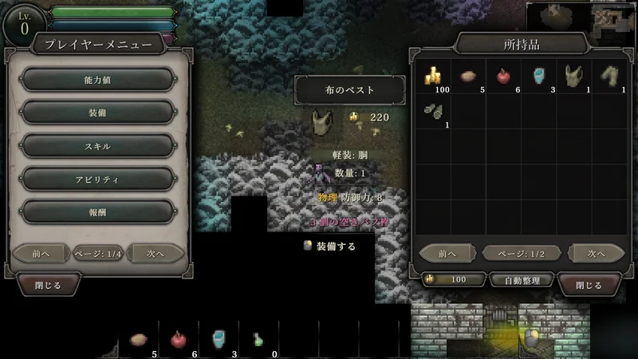

# 9th Dawn III 非公式日本語化パッチ (jpfix)

Steam 版「9th Dawn III」のメニュー・アイテム・スキル・会話などを日本語で表示する非公式パッチです。
ゲームのファイルは書き換えず、ファイルを置くだけで導入できます。MOD ローダー BepInEx を同梱しています。

- 紹介ページ: https://higesho.github.io/9thDawnIII-jpfix/
- ダウンロード: [Releases](https://github.com/higesho/9thDawnIII-jpfix/releases/latest)

## 導入方法
1. [Releases](https://github.com/higesho/9thDawnIII-jpfix/releases/latest) から zip をダウンロードして展開します。
2. Steam のライブラリで 9th Dawn III を右クリック →「管理」→「ローカルファイルを閲覧」で、ゲームフォルダ（`9th Dawn III Launcher.exe` と `GameBin` フォルダがあるフォルダ）を開きます。
3. zip の中の `GameBin` フォルダを、ゲームフォルダにそのままコピーします（「同じ名前のフォルダーがあります」と出たら統合）。`GameBin` の中に `winhttp.dll` と `BepInEx` フォルダが増えていれば OK です。
4. いつもどおり Steam からゲームを起動します。

解除するには、`GameBin` フォルダの `winhttp.dll` を削除してください。
すでに BepInEx 5 を使っている場合は、`GameBin\BepInEx\plugins\9thDawnIII_JP` フォルダだけをコピーしてください。

## 日本語にならないとき
ゲームを一度起動したあと、`GameBin\BepInEx\LogOutput.log` と `GameBin\BepInEx\plugins\9thDawnIII_JP\jpfix.log` ができているか確認してください。

- **LogOutput.log がない**：BepInEx が動いていません。
  - `winhttp.dll` と `doorstop_config.ini` が `9th Dawn III.exe` と同じ `GameBin` フォルダにあるか確認してください。
  - ウイルス対策ソフトが `winhttp.dll` を削除・隔離していないか確認してください。
  - Steam Deck / Linux（Proton）では、起動オプションに `WINEDLLOVERRIDES="winhttp=n,b" %command%` を入力してください。
- **jpfix.log がある**：ログを添えて Issues でお知らせください。

## 対応バージョン
Steam 版 9th Dawn III（Windows 版、Steam ビルドID 22484469）。
ゲーム本体のプログラムは書き換えない方式のため、更新後も多くの場合はそのまま動きます。

## 不具合・誤訳の報告
英語のまま残った文や誤訳を見つけたら [Issues](https://github.com/higesho/9thDawnIII-jpfix/issues) で教えてください。

## 権利・免責
- 「9th Dawn III」の著作権は Valorware に帰属します。本パッチは非公式のもので、Valorware および Valve（Steam）とは関係ありません。
- 本パッチはゲームのファイルを含まず、改変もしません。
- 本パッチの使用によって生じたいかなる損害についても、作者は責任を負いません。
- 日本語フォントは Noto Serif JP（© 2017-2023 Adobe、SIL Open Font License 1.1）を、使う文字だけに絞り書体名を変えたものです。
- 同梱の BepInEx 5.4.23.6 は公式配布版を改変せずに収録しています（BepInEx・UnityDoorstop: LGPL-2.1、HarmonyX・MonoMod・Mono.Cecil: MIT）。ソースは [BepInEx](https://github.com/BepInEx/BepInEx/releases/tag/v5.4.23.6)、[UnityDoorstop](https://github.com/NeighTools/UnityDoorstop)、[HarmonyX](https://github.com/BepInEx/HarmonyX)、[MonoMod](https://github.com/MonoMod/MonoMod)、[Mono.Cecil](https://github.com/jbevain/cecil) から入手できます。

## 関連
- [9th Dawn II 非公式日本語化パッチ](https://higesho.github.io/9thDawnII-jpfix/)
- [9th Dawn Classic 非公式日本語化パッチ](https://higesho.github.io/9thDawnClassic-jpfix/)
